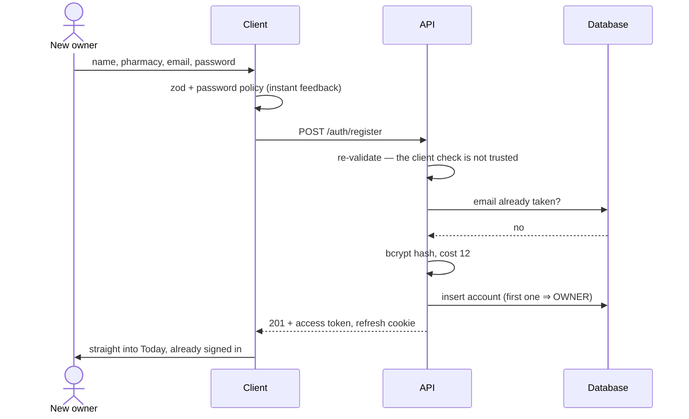
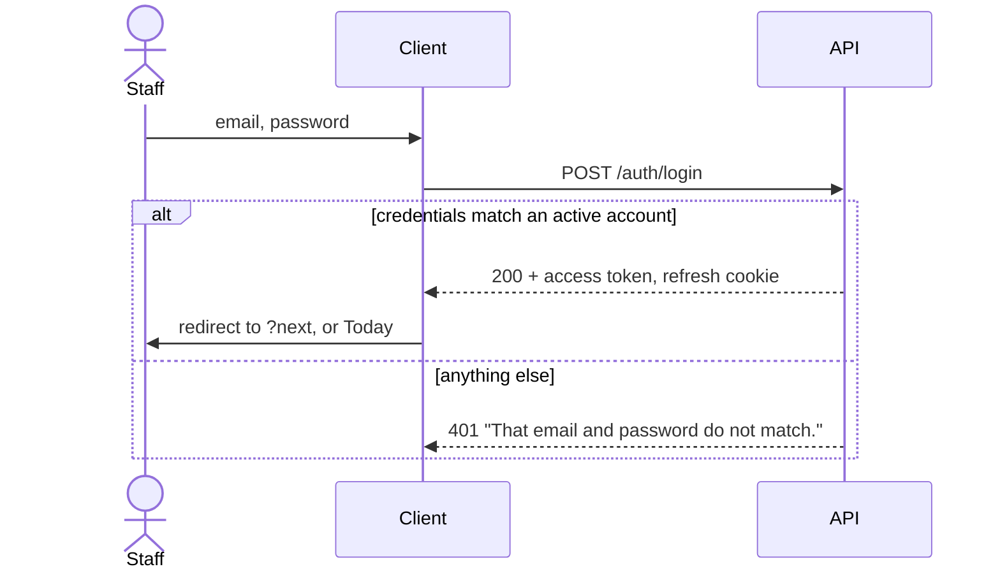

# Authentication — design and flow

Everything behind the counter is attached to a named person. That is not a
formality: returns and write-offs remove stock from the books, and the system's
central safeguard is that **one person asks and a different person signs**. If
identity is weak, that safeguard is theatre.

This document covers the whole round trip: the four screens in
`pharmawatch_frontend`, and the endpoints in `pharmawatch_backend` that serve
them. Both halves are built — there is no stand-in left.

---

## 1. The model

| Thing | Fields |
|---|---|
| Account | `id`, `name`, `email` (unique, lowercased), `passwordHash`, `role`, `pharmacyId`, `isActive`, `createdAt` |
| Role | `OWNER` or `PHARMACIST` |
| Session | access token (15 min, memory) + refresh token (7 days, httpOnly cookie) |
| Reset token | `tokenHash`, `accountId`, `expiresAt` (30 min), `usedAt` |

**The first account to sign up owns the pharmacy.** Everyone after that is a
pharmacist, added by the owner. This is what makes the two-person rule hold on
day one without a seeding step.

### What each role may do

| Action | Pharmacist | Owner |
|---|---|---|
| Sell at the counter | ✅ | ✅ |
| Receive a batch | ✅ | ✅ |
| Apply a discount | ✅ | ✅ |
| Request a return or write-off | ✅ | ✅ |
| **Approve or reject a request** | ❌ | ✅ |
| Approve *their own* request | ❌ | ❌ |

That last row is the one worth defending. It is enforced in
[`src/domain/approvals.ts`](../src/domain/approvals.ts) as `canDecide()`, tested
from all four angles in [`tests/approvals.test.ts`](../tests/approvals.test.ts),
and must be re-checked server-side before any status write.

---

## 2. Screens

| Route | Screen | Indexed |
|---|---|---|
| `/signin` | Email, password, keep-me-signed-in | no |
| `/signup` | Name, pharmacy, email, password + live policy meter, confirm, responsibility checkbox | no |
| `/forgot-password` | Email → "a link is on its way" | no |
| `/reset-password?token=…` | New password + confirm → done | no |

All four are `robots: noindex, nofollow`. They sit in the `(auth)` route group,
which has no header and no navigation — there is nothing to navigate to until
you are signed in.

Everything else sits in the `(app)` group behind
[`RequireSession`](../src/components/auth/RequireSession.tsx), which redirects
to `/signin?next=<path>` and returns you there after a successful sign-in.

### The three states a guard must have

The access token lives in JavaScript memory, so a reload always starts with no
session at all: the client has to ask `POST /auth/refresh` whether the httpOnly
cookie still stands for one. That answer takes a round trip, so auth status is
**`booting` → `anon` | `authed`**, never a bare boolean. Treating "not yet
known" as "signed out" is what makes apps flash their login screen on every
reload.

---

## 3. The flows

### Sign up



### Sign in



The failure message is deliberately identical for a wrong password and an email
that has no account. Two different messages turn the login form into a tool for
discovering who banks here.

### Forgot and reset

```mermaid
sequenceDiagram
  actor U as Staff
  participant C as Client
  participant A as API
  participant M as Mail

  U->>C: email
  C->>A: POST /auth/forgot-password
  A-->>C: 200 { sent: true }  ← always, known address or not
  opt the address exists
    A->>A: random 32 bytes; store SHA-256 of it, 30 min TTL
    A->>M: link with the raw token
  end
  U->>C: opens /reset-password?token=…
  C->>A: POST /auth/reset-password
  A->>A: hash the token, look it up, check expiry and usedAt
  A->>A: bcrypt the new password, mark token used, revoke all refresh tokens
  A-->>C: 200 { ok: true }
  C->>U: "changed — sign in again"
```

Three decisions in there are worth saying out loud:

1. **`{ sent: true }` is returned for unknown addresses too.** Same reason as
   the login message.
2. **Only a hash of the reset token is stored.** A leaked database then yields
   no usable links.
3. **Changing the password revokes every refresh token.** "I think someone has
   my password" has to have an answer, and this is it.

---

## 4. Tokens

| | Access | Refresh |
|---|---|---|
| Lifetime | 15 minutes | 7 days, re-issued on every use |
| Where | JavaScript memory only | `httpOnly` cookie, scoped to `/api/v1/auth` |
| Readable by script | yes | **no** |
| Sent how | `Authorization: Bearer` | automatically, with `credentials: "include"` |

In production the cookie is `Secure; SameSite=None` so the API can live on its
own host; in development it is `SameSite=Lax` on plain HTTP. **Keep me signed
in** is what decides whether it carries a `Max-Age` at all — unticked, it is a
session cookie and dies with the browser.

The split is the usual XSS-versus-CSRF trade. A token in `localStorage` is
readable by any script that gets injected; a cookie is not, but a cookie is sent
on cross-site requests — which `SameSite=Strict` prevents. So: the long-lived
credential goes in the cookie where script cannot reach it, and the short-lived
one stays in memory where a cookie attack cannot use it.

Revocation hangs on `tokenVersion`, a counter on the account that every token
carries. Changing or resetting a password bumps it, and every refresh token
issued before that moment stops verifying — one write signs every open session
out.

> **What is not built:** refresh-token *reuse detection*. A stolen refresh token
> stays usable until it expires or the password changes; the server does not
> keep a record of spent tokens, so replaying one is not noticed. Storing the
> issued token's hash per session is the next step, and it is listed in the
> backend README rather than claimed here.

---

## 5. Passwords

Defined once, in [`src/domain/password.ts`](../src/domain/password.ts), so the
browser and the server cannot drift apart:

- at least 10 characters
- an upper and a lower case letter
- a number
- not on the common-password list
- not built from the account's own email

Stored as **bcrypt, cost 12**. The hash is never selected into a response —
that is an explicit field list on the query, not a `delete user.password` after
the fact, because the latter only has to be forgotten once.

The meter on `/signup` is feedback, not enforcement. `POST /auth/register`
re-runs the identical rules, and the only reason the client has them at all is
so the viewer finds out before pressing the button.

---

## 6. Rate limits and lockout

| Endpoint | Limit | Env |
|---|---|---|
| `POST /auth/login` | 5 per 15 min per IP **and** per email | `RATE_LIMIT_LOGIN` |
| `POST /auth/forgot-password` | 3 per hour per email | `RATE_LIMIT_FORGOT` |
| `POST /auth/reset-password` | 5 per hour per IP | `RATE_LIMIT_RESET` |
| `POST /auth/register` | 3 per hour per IP | `RATE_LIMIT_REGISTER` |

The numbers are configuration, not constants, which is why the browser suite can
raise them for one run without touching the middleware.

Limiting by IP alone lets a botnet spread one password across many addresses;
limiting by email alone lets anyone lock a colleague out on purpose. Both, and
neither failure mode works.

---

## 7. Endpoints

All responses use the project envelope:

```jsonc
{ "success": true,  "statusCode": 200, "message": "Signed in", "data": { ... } }
{ "success": false, "statusCode": 400, "message": "…",
  "errors": [{ "path": "password", "message": "…" }] }
```

`errors[0].path` is what lets the client put the message under the right input
instead of in a banner — it becomes `ApiError.field`.

| Method | Path | Body | Returns |
|---|---|---|---|
| `POST` | `/api/v1/auth/register` | name, pharmacy, email, password | account + sets refresh cookie |
| `POST` | `/api/v1/auth/login` | email, password, remember | account + sets refresh cookie |
| `POST` | `/api/v1/auth/refresh` | — (cookie) | new access token, rotated cookie |
| `POST` | `/api/v1/auth/logout` | — | clears the cookie, revokes the token |
| `GET` | `/api/v1/auth/me` | — | the signed-in account |
| `POST` | `/api/v1/auth/forgot-password` | email | `{ sent: true }` |
| `POST` | `/api/v1/auth/reset-password` | token, password | `{ ok: true }` |

Status codes: `400` validation, `401` bad or missing credentials, `403` signed
in but not permitted (a pharmacist approving), `409` email already taken, `429`
rate limited.

---

## 8. How the client is wired

```
src/lib/api/
├── client.ts    fetch + envelope + the access token + one retry through /auth/refresh
├── error.ts     ApiError, carrying status and the offending field
└── wire.ts      the shapes the server actually sends

src/lib/auth/
├── types.ts     the AuthApi contract — six methods, nothing else
├── session.ts   SessionUser, initials, ApiError re-exported as AuthError
└── index.ts     the one implementation, speaking to the API
```

The access token is a module-level variable in `client.ts` and nothing else can
see it. A `401` on any data call triggers exactly one `/auth/refresh` and one
retry; if that fails the token is dropped and the guard sends you to `/signin`.

```
src/store/
├── auth.thunks.ts   signIn, signUp, requestReset, resetPassword, signOut, restoreSession
└── auth.slice.ts    user, status, busy, failure, resetSent, resetDone
```

`pharmacy.slice` reads the role off the signed-in account via `extraReducers`,
so there is no separate "view as" control any more. Being the owner is a fact
about who you signed in as, not a setting.

---

## 9. What is deliberately left out

- **Email.** `forgot-password` returns the token in the response outside
  production instead of sending a message. The token is already hashed in the
  database, single use and 30 minutes old, so only the delivery is missing.
- **Refresh reuse detection**, as above.
- **Account lockout.** Rate limiting slows an attacker down; it never locks a
  real pharmacist out of their own counter, which in a shop at 9pm is the worse
  failure.

---

## 10. Seeded accounts

`pnpm seed` in `pharmawatch_backend` creates two accounts. They live in the
database, not in the frontend, and the sign-in card does not advertise them.

| Email | Role |
|---|---|
| `owner@pharmawatch.test` | Owner — can approve |
| `rafiq@pharmawatch.test` | Pharmacist — can request only |

Password for both comes from `OWNER_PASSWORD` in the backend `.env`
(`Pharma@2026` in `.env.example`).

To see the two-person rule work: sign in as Rafiq, open a critical batch, request
a return. Go to Approvals — the buttons are disabled and say why. Sign out, sign
in as Mahmuda, and decide it.
